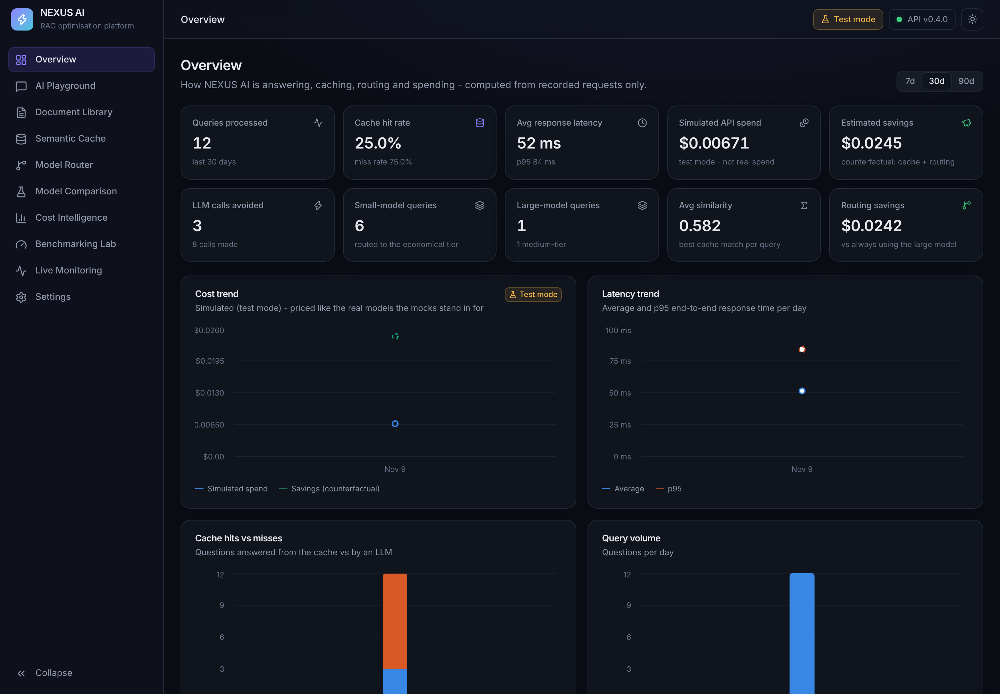
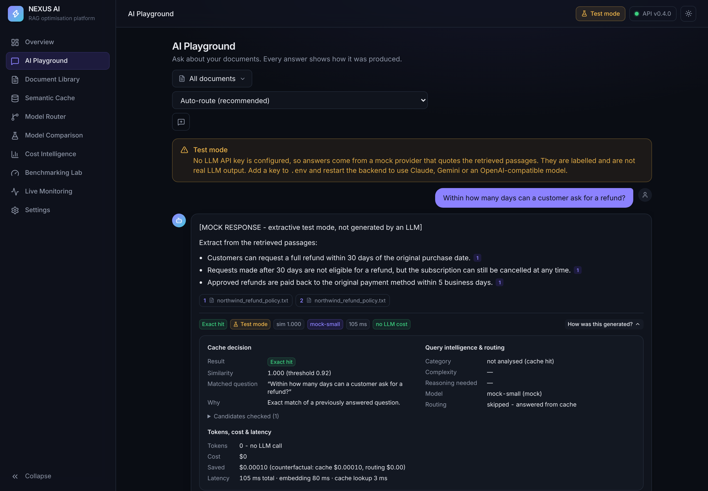
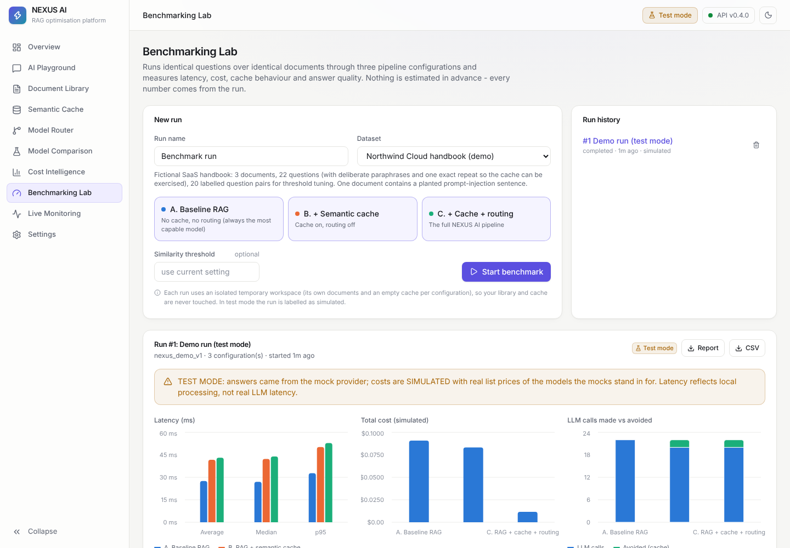

# NEXUS AI
**Intelligent RAG Optimization and Cost-Aware Model Orchestration Platform**
*Making AI smarter, faster and more cost-efficient.*

NEXUS AI answers questions about your own documents (Retrieval-Augmented Generation) and cuts
LLM cost and latency with two optimisations that are measured, not claimed:

1. **Context-aware semantic cache** - a new question that means the same as an earlier one, asked
   against the same unchanged documents, reuses the stored answer (no LLM call).
2. **Cost-aware model routing** - each question is classified (factual, conceptual, analytical,
   comparative, mathematical, multi-step; simple/medium/complex) and sent to the cheapest model tier
   that suits it, with automatic fallback when a provider fails.

A Benchmarking Lab compares plain RAG against RAG + cache and RAG + cache + routing on a reproducible dataset.

> **Status:** see [DEVELOPMENT_CHECKLIST.md](DEVELOPMENT_CHECKLIST.md) for exactly what is implemented,
> what was tested and how, and what is still open. Without API keys the app runs in a clearly
> labelled **test mode** (mock answers, simulated costs).

---

## Windows installation (first time)

### 1. Install the prerequisites (once)

| Tool | Version | Get it |
|---|---|---|
| Python | 3.11 - 3.13 (3.12 recommended) | https://www.python.org/downloads/ - tick **"Add python.exe to PATH"** |
| Node.js | 22.12+ (current LTS) | https://nodejs.org/ |
| Git (optional) | any | https://git-scm.com/download/win |

Close and reopen VS Code afterwards so the new PATH is picked up.

### 2. Run the setup script

Open the project folder in VS Code → **Terminal → New Terminal** (PowerShell). Check the prompt shows
the project folder, then run:

```powershell
powershell -ExecutionPolicy Bypass -File .\setup_windows.ps1
```

It checks Python/Node, creates `backend\.venv`, installs the Python and npm packages, creates `.env`
from `.env.example` (never overwrites an existing one), creates/upgrades the database and downloads
the embedding model. First run: 5-15 minutes (PyTorch is large). Success ends with:

```
[OK] Embedding model works (vector size = 384)
[DONE] Initialisation complete.
  Setup complete!
```

Optional flags: `-RunTests` (also runs the backend tests), `-SkipFrontend`, `-SkipModelDownload`.
Double-clicking `SETUP.bat` does the same thing.

### 3. (Optional) add API keys

Edit `.env` in the project folder:

* `ANTHROPIC_API_KEY` - https://console.anthropic.com → API Keys
* `GEMINI_API_KEY` - https://aistudio.google.com → Get API key, then choose the Gemini models in
  **Settings → LLM providers → +** (the list comes from Google's API) and enter their prices.
* Any OpenAI-compatible server (OpenAI, Ollama, LM Studio, OpenRouter) via `OPENAI_COMPAT_*`.

Restart the backend after editing `.env`. Keys stay on your computer: they are never sent to the browser.

## Every day

```powershell
.\start_all.bat
```

Two windows open ("NEXUS AI - Backend", "NEXUS AI - Frontend"); the launcher waits until both answer
and opens the browser.

| URL | What |
|---|---|
| http://localhost:5173 | Dashboard |
| http://localhost:8000 | Backend API |
| http://localhost:8000/docs | Swagger API documentation |

Stop everything with `.\stop_all.bat`. (`START.bat` still works and calls `start_all.bat`.)

### Run the tests

```powershell
cd backend; .\.venv\Scripts\python.exe -m pytest; cd ..
```

```powershell
cd frontend; npm test; cd ..
```

## Screenshots

Captured in test mode (mock LLM, simulated costs) during development.

| Overview (dark) | AI Playground - "how was this generated?" |
|---|---|
|  |  |



## Features

| # | Feature | Where |
|---|---|---|
| 1 | Multi-document RAG: PDF/TXT/MD upload, extraction, chunking, MiniLM embeddings, ChromaDB, grounded answers with citations, versioned updates, deletion, duplicate detection | Document Library, AI Playground |
| 2 | Semantic cache: exact + cosine-similarity matching, configurable threshold, TTL, invalidation on document change/delete, tenant + document-scope isolation, intent guard (category, numbers, negation, qualifiers) | Semantic Cache |
| 3 | Model routing: rule-based complexity routing, 3 strategies, manual override, fallback chain | Model Router |
| 4 | Threshold optimizer: measured reuse vs wrong-match rates on labelled pairs, safety-first recommendation | Semantic Cache |
| 5 | Model comparison: same context to several models, latency/tokens/cost/faithfulness, Markdown report | Model Comparison |
| 6 | Cost intelligence: provider-reported vs estimated tokens, priced/simulated/unpriced costs, counterfactual cache & routing savings, daily/weekly/model charts | Cost Intelligence |
| 7 | Cache management: search, filter, inspect (why it matched, document versions, hit history), delete, clear | Semantic Cache |
| 8 | Query intelligence: 6 categories, complexity score, retrieval/reasoning needs, explanation | Model Router, Playground |
| 9 | Benchmarking: A baseline / B cache / C cache + routing on a reproducible dataset, avg/median/p95 latency, hit rate, calls, tokens, cost, retrieval relevance, correctness, faithfulness, MD/CSV reports | Benchmarking Lab |
| 10 | Live monitoring: per-stage event stream, query volume, latency, cost, errors, service status | Live Monitoring |

## Architecture

```
Browser (React + TS + Vite + Tailwind + Framer Motion + Recharts)
   │  /api/*  (Vite proxy → 127.0.0.1:8000; no API keys in the browser)
FastAPI ── services/pipeline.py:  validate → embed → semantic cache
   │                                hit  → validated cached answer
   │                                miss → retrieve → analyse → route → LLM (fallback) → cache → analytics
   ├── embeddings/  all-MiniLM-L6-v2 (384-dim, normalised)
   ├── rag/         extract · chunk · ChromaDB · retrieval · injection-safe prompt
   ├── cache/       semantic cache + context validation
   ├── router/      query intelligence + model router
   ├── llm/         Claude · Gemini · OpenAI-compatible · mock (one interface) + pricing
   ├── analytics/   metrics + event log      evaluation/  benchmarks · threshold · comparison
   └── storage:     SQLite (data/nexus.db, additive migrations)  +  ChromaDB (data/chroma)
```

Details: [docs/architecture.md](docs/architecture.md) · methodology: [docs/methodology.md](docs/methodology.md)
· evaluation: [docs/evaluation.md](docs/evaluation.md) · audit of v3.1: [docs/AUDIT_REPORT.md](docs/AUDIT_REPORT.md).

## Security

API keys only in `.env` (git-ignored); keys never returned by any endpoint · upload validation (type,
PDF signature, size, filename sanitising) · input validation (Pydantic) · per-client rate limiting ·
request-size limit · tenant isolation for documents and cache · retrieved text treated as untrusted
data (wrapped, markup neutralised, injection tripwire) · central error handler (no stack traces to
clients) · logs contain IDs and timings, never document text or answers · security headers · CORS
limited to the dashboard origin.

